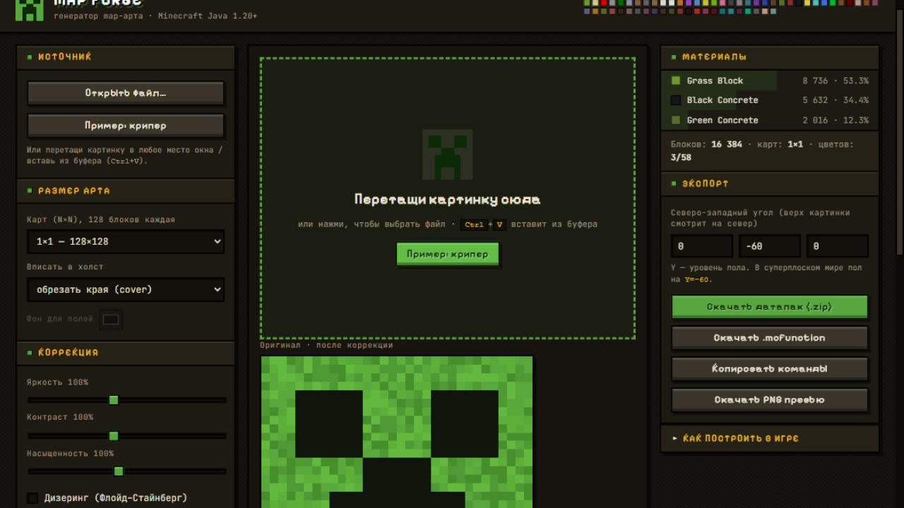
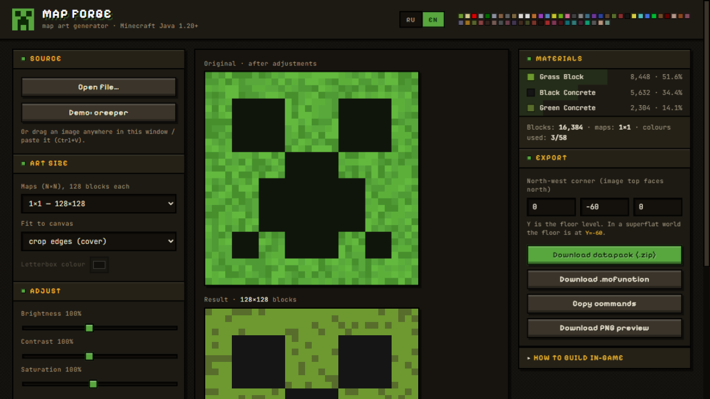

# MAP FORGE 🎨⛏

**RU** · [EN ниже](#english)

Генератор map-арта для Minecraft (Java Edition 1.20+): превращает любую картинку — мем, логотип, скриншот — в постройку из блоков и выдаёт готовый датапак с командами. Всё считается прямо в браузере, интернет не нужен.



## Быстрый старт

1. Открой **`map-forge.html`** двойным кликом — это весь сайт, один файл без зависимостей.
2. Перетащи картинку в окно (или `Ctrl+V`, или кнопка «Открыть файл»). Есть и демо-режим «Пример: крипер».
3. Подкрути яркость/контраст/насыщенность, включи дизеринг, выбери размер арта.
4. Нажми **«Скачать датапак (.zip)»** и положи его в `saves/ТвойМир/datapacks/`.
5. В игре: `/reload`, затем `/function mapart:art` — постройка появится от заданного угла (X; Y; Z), верх картинки смотрит на север.
6. Возьми пустую карту и активируй её, стоя в области арта — карта привязывается к сетке 128×128. Готовый арт вешай в рамку на стену.

## Возможности

- Размер арта от 1×1 до 4×4 карт (128–512 блоков)
- Два режима постройки:
  - **Плоский** — все блоки в один уровень, минимум материалов; команды сжимаются в `fill`-прогоны
  - **Ступенчатый** — рельеф «лесенкой» на север–юг даёт 3 тона каждого цвета: точнее картинка, но блоков намного больше
- Дизеринг Флойда–Стайнберга, яркость/контраст/насыщенность, вписывание с фоном или обрезка
- Живое превью с зумом, сеткой карт и подсказкой по каждому пикселю (блок, тон, высота колонки)
- Панель материалов: сколько и каких блоков нужно, с процентами
- Экспорт: датапак `.zip` (работает и на 1.20.x, и на 1.21+), `.mcfunction`, копирование команд, PNG-превью
- Интерфейс на русском и английском (переключатель RU/EN в шапке, выбор запоминается)

## Как это устроено

- Палитра — 58 реально достижимых цветов карт Java Edition 1.20 (полупрозрачные и непостроечные блоки вроде воды, льда и паутины выброшены). Данные взяты из проекта [MapArtCraft](https://github.com/rebane2001/mapartcraft).
- Тон пикселя — это высота колонки блоков относительно соседа с севера: выше на 1 → светлый тон, ниже на 1 → тёмный, вровень → обычный. Модель сверена с генератором NBT из MapArtCraft.
- «Нублайн» — служебный ряд блоков севернее арта, задающий тон верхнего ряда. Не ломай его, пока не снял карту.
- Подбор блока на цвет: приоритет бетону > шерсти > терракоте, блоки-«подложки» (ковры, растения, плиты) отфильтрованы.

## Сборка из исходников

| Файл | Что это |
|---|---|
| `map-forge.html` | Готовый сайт — его открываешь и пользуешься |
| `app.template.html` | Шаблон интерфейса с меткой `__PALETTE__` |
| `palette.json` | Вырезанная палитра 1.20 (58 цветов: тона + блок) |
| `coloursJSON.json` | Полные данные палитры из MapArtCraft |
| `build-palette.js` | `node build-palette.js` — собирает `palette.json` |
| `build-app.js` | `node build-app.js` — вшивает палитру в шаблон → `map-forge.html` |

Нужен только [Node.js](https://nodejs.org): `node build-palette.js && node build-app.js`.

---

<a name="english"></a>
## English

**MAP FORGE** is a map-art generator for Minecraft (Java Edition 1.20+). It turns any image — a meme, a logo, a screenshot — into a block-by-block build and exports a ready-to-use datapack with all commands. Everything runs locally in your browser; no internet required.



### Quick start

1. Double-click **`map-forge.html`** — the whole app is a single dependency-free file.
2. Drop an image into the window (or `Ctrl+V`, or use **Open file**). There's a built-in **Demo: creeper**.
3. Tweak brightness/contrast/saturation, toggle dithering, pick the art size.
4. Hit **Download datapack (.zip)** and place it into `saves/YourWorld/datapacks/`.
5. In game: `/reload`, then `/function mapart:art`. The build appears at the corner you set (X; Y; Z), with the image top facing north.
6. Activate an empty map while standing inside the art area — maps snap to a 128×128 grid. Display the map in an item frame.

### Features

- Art sizes from 1×1 to 4×4 maps (128–512 blocks)
- Two build modes: **flat** (level floor, fewest blocks, RLE-compressed `fill` runs) and **staircased** (north–south terracing unlocks 3 tones per colour — more accurate, many more blocks)
- Floyd–Steinberg dithering, brightness/contrast/saturation, crop or letterbox fit
- Live preview with zoom, map grid and a per-pixel tooltip (block, tone, column height)
- Materials panel with exact block counts and percentages
- Export: `.zip` datapack (works on 1.20.x and 1.21+), `.mcfunction`, copy-to-clipboard, PNG preview
- UI in Russian and English (RU/EN toggle in the header, choice is remembered)

### How it works

- The palette is the 58 actually achievable map colours of Java Edition 1.20 (translucent/unbuildable blocks like water, ice and cobwebs removed). Palette data comes from [MapArtCraft](https://github.com/rebane2001/mapartcraft).
- A pixel's tone is the column height relative to its northern neighbour: +1 → light tone, −1 → dark tone, equal → normal tone. The model matches MapArtCraft's NBT generator.
- The **noobline** is a scaffold row of blocks just north of the art that sets the top row's tone — don't break it until you've captured the map.
- Block choice per colour prefers concrete > wool > terracotta; support-needy blocks (carpets, plants, slabs) are filtered out.

### Building from source

Requires [Node.js](https://nodejs.org):

```bash
node build-palette.js   # coloursJSON.json -> palette.json
node build-app.js       # app.template.html + palette.json -> map-forge.html
```

---

Палитра и модель тонов: данные [MapArtCraft от rebane2001](https://github.com/rebane2001/mapartcraft). Сайт собран в ZCode.
